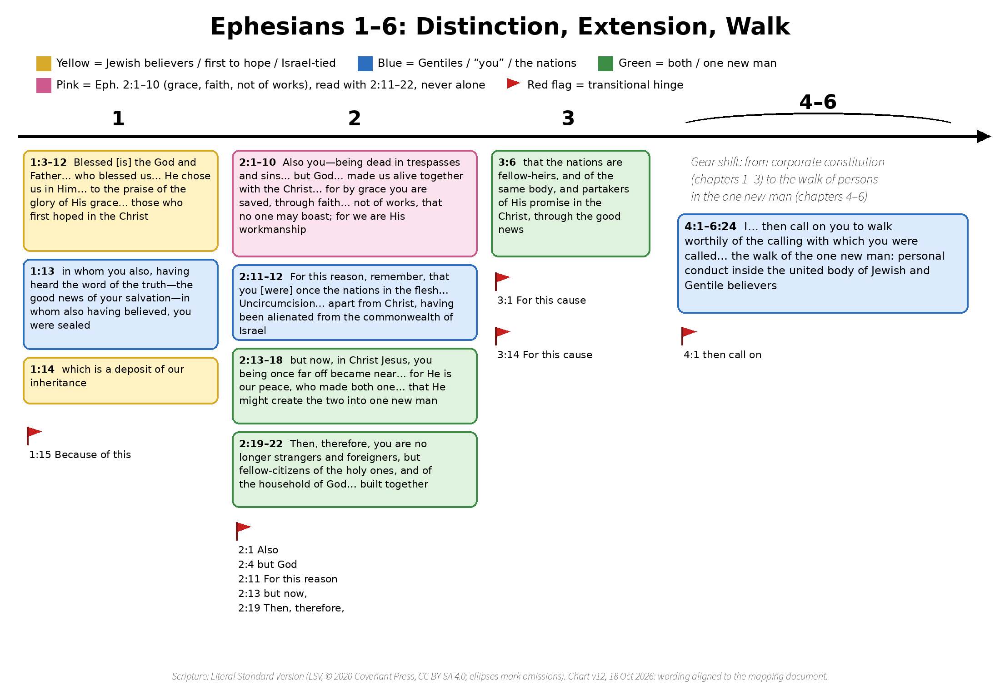
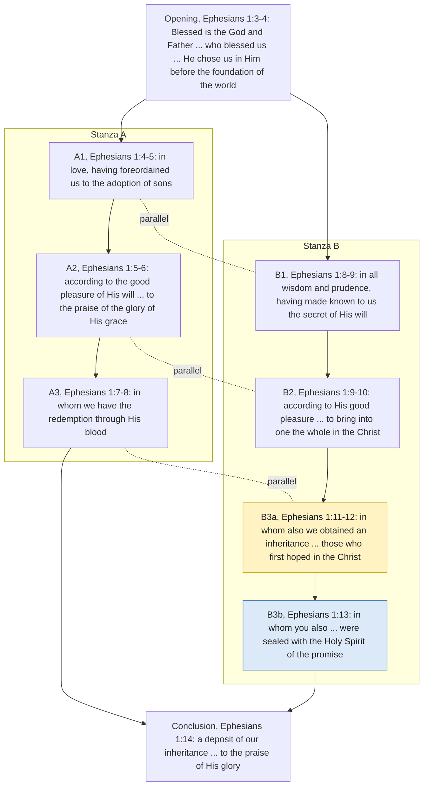
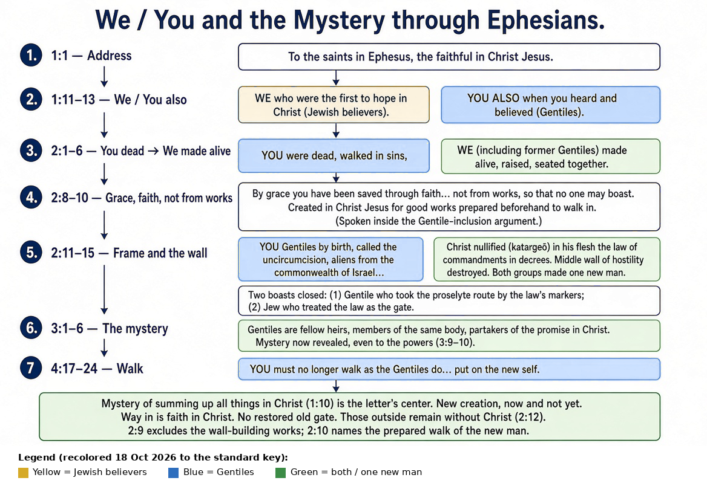

# Ephesians 2: the audience, the wall, and the new creation
{: .no_toc}

## Contents
{: .no_toc}

* Contents
{:toc}

---

## About this example

A worked passage study, prepared as the handout for the first session of a two-person study of Ephesians. It reads Ephesians 2:1–10 inside the letter’s own argument about how Gentiles are brought into the one new man (Ephesians 2:11–22), using a color-coded [audience mapping of Ephesians 1–6](ephesians-1-6-audience-mapping.md). It is written as committed advocacy from an Eastern Orthodox reader for one reading of Ephesians 2:9, with the strongest objections stated and answered, and the other traditions set out from their own sources. An AI assistant helped draft and check it; it is not cited as a source, and every quotation was checked against the edition named.

## Part 1: Handout (two pages)

### Time plan (75 minutes)

| Minutes | Step |
|---|---|
| 0–5 | Open in prayer; read Ephesians 2:1–22 aloud (LSV), one reader per paragraph |
| 5–15 | Mark the pronouns on the mapping: who is “you,” who is “we,” where does “both” begin? |
| 15–30 | Claim A: the letter’s frame (two peoples made one) |
| 30–50 | Claim B: what “not of works” excludes (Ephesians 2:9), and the strongest objection to it |
| 50–70 | Questions 1–6 below |
| 70–75 | Application, and close in prayer |

### The two claims

**Claim A (the foundation).** Ephesians 1–3 speaks in a corporate register. The “we… who first hoped in the Christ” (Ephesians 1:12) and the “you also” (Ephesians 1:13) are two peoples; Ephesians 2:11–22 states their union outright; Ephesians 3:6 calls it the secret now revealed. Persons believe (Ephesians 1:13), but the argument is about how two peoples become “one new man” (Ephesians 2:15).

**Claim B (argued here).** The “works” that Ephesians 2:9 excludes are, first, the works of the Law that functioned as the dividing wall: the “Law of the commands in ordinances” that Christ did away with (Ephesians 2:15). The boast that is closed is the boast those works made possible. The “good works” of Ephesians 2:10 are a different thing: the walk God prepared for the new creation.

Claim A can stand without Claim B. Claim B depends on Claim A.

### Key verses

> for by grace you are saved, through faith, and this [is] not of yourselves—[it is] the gift of God, not of works, that no one may boast; for we are His workmanship, created in Christ Jesus on good works, which God prepared before, that we may walk in them.
>
> — Ephesians 2:8–10, LSV

> For this reason, remember, that you [were] once the nations in the flesh, who are called Uncircumcision by that called Circumcision in the flesh made by hands… for He is our peace, who made both one, and broke down the middle wall of the partition of hostility, the enmity in His flesh, having done away [with] the Law of the commands in ordinances, that He might create the two into one new man in Himself, making peace,
>
> — Ephesians 2:11, 2:14–15, LSV

### Questions

1. **Your own reading first.**  When you hear “not of works, that no one may boast” (Ephesians 2:9), what works come to mind, and why those? Does Ephesians 2:11–15 change your answer?
2. **The pronouns.** Who is the “we also all” of Ephesians 2:3? Jewish believers (Witherington) or all believers (Thielman)? What in the text decides it?
3. **“For this reason” (Ephesians 2:11).** Does it make Ephesians 2:1–10 the general ground that 2:11–22 then applies, or does it show that 2:1–10 was already about the Gentile “you”?
4. **Steelman the Reformed reading.** Make the strongest case you can that Ephesians 2:8–9 excludes all human works as the ground of salvation (Westminster Confession 11.1; Romans 4:4–5; Titus 3:5). Then name what it must explain in Ephesians 2:11–15.
5. **What was done away?** Ephesians 6:2–3 quotes “honor your father and mother” as “the first command with a promise,” after Ephesians 2:15. What does that tell us about what Christ “did away with”?
6. **Application.** What would it look like this week to walk in “the good works God prepared before” (Ephesians 2:10), and is there any wall we are still building?

### Legend

| Color | Meaning |
|---|---|
| <strong>Yellow (gold)</strong> | Jewish believers, “those who first hoped,” Israel-tied terms while the distinction is drawn |
| <strong>Blue</strong> | Gentiles, “you,” the nations |
| <strong>Green</strong> | both, the one new man, the shared “fellow-” words |
| <strong>Pink</strong> | the Ephesians 2:1–10 block, always read with Ephesians 2:11–22 |
| <strong>Red flag</strong> | transitional hinge (“but God,” “for this reason,” “but now”) |
{: .aud-legend}

The full key, including Purple (Paul) and Gray (ambiguous), is in the [mapping](ephesians-1-6-audience-mapping.md).

## Part 2: Appendix (the full study)

### Conventions

- **Scripture** is the *Literal Standard Version* (LSV, © 2020 Covenant Press; CC BY-SA 4.0; text unaltered) unless another translation is named. Where the argument turns on the NET’s wording (Ephesians 2:14–15), the NET 2nd edition is quoted and labeled. Ellipses mark omissions. Compare translations at [Bible Gateway](https://www.biblegateway.com/passage/?search=Ephesians%202&version=NET;ESV;NKJV;KJV).
- **NET translators’ notes** are summarized and linked ([netbible.org: Ephesians 2](https://netbible.org/bible/Ephesians+2)).
- **Commentaries** under copyright are quoted briefly (about 100 words per author at most) and otherwise summarized, with page numbers. Chrysostom is quoted from the public-domain NPNF translation; confessions from public-domain texts.
- **Verification.** Anything not checked against its source is marked **(unverified)**.

### Chart: Distinction, Extension, Walk (Ephesians 1–6)

*The Ephesians 2:8–10 band sits inside the sequence that continues through Ephesians 2:11–22.*

**Text version of the chart** (LSV wording):

- **Chapter 1**
  - <strong>Yellow</strong> Ephesians 1:3–12: “Blessed [is] the God and Father… who blessed us… He chose us in Him… to the praise of the glory of His grace… those who first hoped in the Christ.”
  - <strong>Blue</strong> Ephesians 1:13: “in whom you also, having heard the word of the truth—the good news of your salvation—in whom also having believed, you were sealed.”
  - <strong>Yellow</strong> Ephesians 1:14: “which is a deposit of our inheritance.”
  - <strong>Red flag</strong> Ephesians 1:15 “Because of this.”
- **Chapter 2**
  - <strong>Pink</strong> Ephesians 2:1–10: “Also you—being dead in trespasses and sins… but God… made us alive together with the Christ… for by grace you are saved, through faith… not of works, that no one may boast; for we are His workmanship.”
  - <strong>Blue</strong> Ephesians 2:11–12: “For this reason, remember, that you [were] once the nations in the flesh… Uncircumcision… apart from Christ, having been alienated from the commonwealth of Israel.”
  - <strong>Green</strong> Ephesians 2:13–18: “but now, in Christ Jesus, you being once far off became near… for He is our peace, who made both one… that He might create the two into one new man.”
  - <strong>Green</strong> Ephesians 2:19–22: “Then, therefore, you are no longer strangers and foreigners, but fellow-citizens of the holy ones, and of the household of God… built together.”
  - <strong>Red flags</strong> Ephesians 2:1 “Also”; Ephesians 2:4 “but God”; Ephesians 2:11 “For this reason”; Ephesians 2:13 “but now,”; Ephesians 2:19 “Then, therefore,”.
- **Chapter 3**
  - <strong>Green</strong> Ephesians 3:6: “that the nations are fellow-heirs, and of the same body, and partakers of His promise in the Christ, through the good news.”
  - <strong>Red flags</strong> Ephesians 3:1 “For this cause”; Ephesians 3:14 “For this cause”.
- **Chapters 4–6** (gear shift from the constitution of the people in chapters 1–3 to the walk of persons in the one new man)
  - <strong>Blue</strong> Ephesians 4:1: “I… then call on you to walk worthily of the calling with which you were called…”
  - <strong>Red flag</strong> Ephesians 4:1 “then call on”.

### A. Claim A: the foundation

#### A.1 The register of Ephesians 1–3

The pronouns name groups: “those who first hoped in the Christ” (Ephesians 1:12) and “you also” (Ephesians 1:13); “you [were] once the nations in the flesh” (Ephesians 2:11); “who made both one” and “the two into one new man” (Ephesians 2:14–15); “the nations are fellow-heirs” (Ephesians 3:6). The argument of these chapters is how two peoples are brought into one new humanity. Persons hear and believe (Ephesians 1:13), and each was dead (Ephesians 2:1), so the corporate frame does not deny individuals; it says what the argument is about. Chapters 4–6 shift gear into the walk and the household. The NET translators read “one new man” in Ephesians 2:15 the same way: a new corporate entity in Christ, not a new individual ([NET note on Ephesians 2:15](https://netbible.org/bible/Ephesians+2)).

#### A.2 The pronoun shift in Ephesians 1:11–14

In Ephesians 1:11–13 Paul speaks of “we” who “obtained an inheritance… those who first hoped in the Christ” and then of “you also, having heard the word of the truth… in whom also having believed, you were sealed.” The “we” are most naturally the Jewish believers; the “you also” are the Gentiles who later heard and believed. On this reading the blessings of the berakah (election, adoption, redemption, the secret of bringing all things into one) are first voiced as the blessings of the people who first hoped, and Ephesians 1:14 speaks of “our inheritance,” the inheritance promised to Israel, of which the Gentiles’ sealing is the deposit. The extension of that inheritance to the Gentiles is argued in Ephesians 2:13–22 and named in Ephesians 3:6 with three “fellow-” words: fellow-heirs, of the same body, partakers (Greek *synklēronoma, syssōma, symmetocha*). The NET translators note that Ephesians 1:12 can also be rendered “who had already hoped” ([NET note on Ephesians 1:12](https://netbible.org/bible/Ephesians+1)).

Readers differ. Witherington takes the “saints” of Ephesians 1:1 and the “we” of Ephesians 1:12 as Jewish Christians (Witherington 2007, pp. 230–231). Selby sees the berakah rehearsing the unity theme, with the shift at Ephesians 1:13 and an inclusive “our” returning at Ephesians 1:14 (Selby 2016, pp. 112–118). Many readers take every “we” in Ephesians 1:3–12 as all believers. The mapping keeps Ephesians 1:14 Yellow because “our inheritance” picks up “we obtained an inheritance” in Ephesians 1:11, and the inheritance is shared only when Ephesians 3:6 says so.

#### A.3 Election in Christ

Witherington stresses “in Christ”: believers were chosen in the preexistent Christ, the Elect One, so the concept is corporate (if one is in Christ, one is elect) rather than a pre-temporal choosing of individuals apart from Christ; he compares it to Israel, where one was elect by being in Israel, individuals could opt out by apostasy, and others, like Ruth, could be grafted in (Witherington 2007, pp. 233–235). William W. Klein develops a corporate view of election at book length (*The New Chosen People*, 1990; bibliographic details verified, contents not consulted for this study).

### B. Claim B: the case

#### B.1 The paragraph names only one system of works

Ephesians 2:1–10 says “not of works” without saying which works. The paragraph that follows answers the question. It opens with “For this reason” (Ephesians 2:11), names the hearers as “the nations in the flesh, who are called Uncircumcision by that called Circumcision in the flesh made by hands,” and within four verses names “the Law of the commands in ordinances” as the thing Christ “did away with” to make the two one (Ephesians 2:15). That is the only body of works the passage names. The first rule of reading is that context supplies the referent of an unqualified word. Here the context supplies the Law, and specifically the Law in its function as the wall.

The same structure appears in the sister letter. Colossians 2:14 says Christ blotted out “the handwriting in the ordinances” (the same Greek word, *dogmasin*, as Ephesians 2:15), and the next sentence draws the consequence:

> Let no one, then, judge you in eating or in drinking, or in respect of a celebration, or of a new moon, or of Sabbaths,
>
> — Colossians 2:16, LSV

Food, festivals and Sabbaths were the visible markers that separated Israel from the nations. When Paul’s own circle uses “ordinances” for what Christ removed, these are the examples it gives.

#### B.2 The boast is the boast of the Law

In Paul the language of boasting attaches again and again to the Law and to Jewish privilege, not to effort in general:

> Behold, you are named a Jew, and rest on the Law, and boast in God,… You who boast in the Law, through the transgression of the Law do you dishonor God?
>
> — Romans 2:17, 2:23, LSV

> Where then [is] the boasting? It was excluded; by what law? Of works? No, but by a law of faith: therefore we reckon a man to be declared righteous by faith, apart from works of law. [Is He] only the God of Jews, and not also of nations? Yes, also of nations; since [there is] one God who will declare righteous circumcision by faith, and uncircumcision through faith.
>
> — Romans 3:27–30, LSV

Romans 3:27–30 is the closest parallel to Ephesians 2:8–11 in the Pauline letters. In one movement it excludes boasting, names the excluded works as “works of law,” and grounds the exclusion in the oneness of God over Jews and nations, circumcision and uncircumcision. Ephesians 2:9–11 has the same three elements in the same order: no boast, not of works, the Uncircumcision and the Circumcision. Galatians 6:13 (“that they may glory in your flesh”) and Philippians 3:3 (“we are the circumcision… glorying in Christ Jesus, and having no trust in flesh”) show the same link: the boast Paul fights is the boast in circumcision and the Law’s markers.

#### B.3 Two kinds of works in one sentence

Ephesians 2:9–10 excludes “works” and in the next breath says we were “created in Christ Jesus on good works, which God prepared before.” If “works” in Ephesians 2:9 meant every human act, the sentence would set works against works. Read with Claim B, it sets two kinds against each other: the works that built the wall, which cannot be the way in, and the walk God prepared for the new creation, which is what the way in is for.

#### B.4 Ephesians 6:2–3: what was done away, and what was not

Ephesians 2:15 says Christ did away with “the Law of the commands in ordinances.” Yet four chapters later the same letter quotes the Law as binding:

> honor your father and mother, which is the first command with a promise, “That it may be well with you, and you may live a long time on the land.”
>
> — Ephesians 6:2–3, LSV (quoting Exodus 20:12)

So the letter itself shows that Ephesians 2:15 did not abolish every command God gave. What was done away was the Law “of the commands in ordinances” as the wall: the decrees that marked Jew from Gentile and kept the hostility in place. The NET renders the verb “nullified,” and its translators’ note offers “rendered inoperative” ([NET note on Ephesians 2:15](https://netbible.org/bible/Ephesians+2)). If the abolished Law is the wall-building Law, the excluded works of Ephesians 2:9 are most naturally the wall-building works.

#### B.5 The two boasts that the Law made possible

Under the Mosaic order a Gentile could enter the covenants by taking on the Law’s markers and becoming a proselyte. “Not of works, that no one may boast” closes the boast of the Jew who treated the Law as the gate (Romans 2:17, 2:23; Romans 3:27) and, more speculatively, the boast of the proselyte who could say the inheritance was now his by the markers he took on. The first is well attested in Paul; the second is an inference with little direct evidence and should be held loosely. “No one” covers both sides of the wall.

#### B.6 Who reads it this way

- **New Perspective readers.** James D. G. Dunn argued that “works of the law” in Paul are first the practices that marked Israel off from the nations (circumcision, food laws, Sabbath) (“The New Perspective on Paul,” *Bulletin of the John Rylands Library* 65, 1983, pp. 95–122; bibliographic details from memory, **unverified**). N. T. Wright reads Ephesians 2 as one argument in which the Jew–Gentile union of Ephesians 2:11–22 is the point of Ephesians 2:1–10 (*Justification: God’s Plan and Paul’s Vision*, 2009; page **unverified**). Dunn himself is reported to treat Ephesians 2:8–9 as broadening “works” beyond the Law (**unverified**); if so, Claim B goes further than Dunn on this verse.
- **Witherington** supports Claim A (corporate election) but explicitly rejects Claim B (section C.4).
- **The Fathers.** None of the Fathers checked for this study reads Ephesians 2:9 in exactly Claim B’s terms, but two support its key move, that the wall of Ephesians 2:14–15 is the Law:
  - **John Chrysostom** (Homily 5) says the Law, “a hedge” given for Israel’s security, “became, however, a middle wall, no longer establishing them in security, but cutting them off from God,” and that Christ “has destroyed the very law itself.” On the “ordinances” he writes: “He either then means faith, calling that an ordinance, (for by faith alone He saved us,) or he means precept, such as Christ gave… Instead of a certain manner of life, He brought in faith.” And on the one new man: “it is not that the Gentile has become a Jew, but that both the one and the other are entered into another condition” (NPNF¹ 13; [New Advent](https://www.newadvent.org/fathers/230105.htm)). For Chrysostom, then, the contrast at Ephesians 2:15 is the Law’s way of life against faith: the same contrast Claim B finds in Ephesians 2:8–9.
  - **Theodoret of Cyrus** is reported by H. A. W. Meyer (*Critical and Exegetical Commentary*, on Ephesians 2:15) to have taken the “enmity” of Ephesians 2:15 as the Mosaic Law, the cause of enmity between Jew and Gentile, and *The Expositor’s Greek Testament* (on Ephesians 2:15) reports that he read “in ordinances” as “evangelical teaching” (and Chrysostom as “the faith”), a reading that commentary rejects because *dogma* in the New Testament means a decree. Secondary reports only; Theodoret’s own text **unverified** (trans. Robert C. Hill, *Theodoret of Cyrus: Commentary on the Letters of St. Paul*, Holy Cross Orthodox Press, 2001).
  - **Jerome, Marius Victorinus and Ambrosiaster** wrote on Ephesians, and are often said to read Ephesians 2:14–15 in terms of the Law. Not checked for this study: **unverified**, not relied on. Sources to check: Ronald E. Heine, *The Commentaries of Origen and Jerome on St Paul’s Epistle to the Ephesians* (Oxford, 2002); Mark J. Edwards, ed., *Ancient Christian Commentary on Scripture* NT 8 (IVP, 1999).

#### B.7 What Claim B does not claim

- It does not say grace is anything but first: the dead are made alive by God (Ephesians 2:4–5), and faith is not “of yourselves” (Ephesians 2:8).
- It does not reduce every Pauline use of “works” to ethnic markers (Romans 4:4–5 is about a wage).
- It does not say Ephesians prints “works of the Law” at Ephesians 2:9. The exact words are “not of works”; “not of the works of the Law that built the wall” is the contextual reading argued above, and should be quoted as such.

### C. Strongest objections and replies

#### C.1 “For this reason” in Ephesians 2:11 makes Ephesians 2:1–10 general

**Objection.** The Greek *dio* draws an inference. Ephesians 2:11–22 applies what 2:1–10 established, so 2:1–10 is the general ground (death in sin, rescue by grace, works excluded), and its “works” cannot be limited by what comes after.

**Reply.** The inference shows how the writer meant 2:1–10 to be heard. What follows “for this reason” is “remember, that you [were] once the nations in the flesh”: the conclusion drawn from 2:1–10 is ethnic, so the “you” who “were dead” in Ephesians 2:1 is the same Gentile “you” of Ephesians 2:11. Chrysostom ties the “Wherefore” to Ephesians 2:10, not to a general doctrine of works: “Why, wherefore? Because we have been created unto good works… remember… that you were aforetime Gentiles” (Homily 5). Claim B also does not deny that 2:1–10 contains universal truths (death, grace, faith as gift); it claims that the specific word “works” takes its referent from the argument the paragraph serves.

**What is conceded.** “For this reason” does make 2:1–10 logically prior. The objection is strongest if 2:1–10 is read as a self-contained summary of the gospel; that is a coherent reading.

#### C.2 “We also all… as also the others” (Ephesians 2:3) is universal

**Objection.** Ephesians 2:3 says “we also all walked once in the desires of our flesh… and were by nature children of wrath—as also the others.” The plight is universal, so the remedy, and the excluded works, are universal too.

**Reply.** Claim B agrees the plight is universal; that is what makes it work. If the “we” includes the Jews (Witherington’s reading), then the people who had the Law were also “children of wrath,” so the Law’s works were not a way out of death; that is exactly Romans 3:19–20 (“by works of law will no flesh be declared righteous”). A universal plight under the Law is the reason the Law’s works are excluded and the wall can come down.

**What is conceded.** If the “we” of Ephesians 2:3 is simply all believers (Thielman’s reading), the verse gives no help to an ethnic frame inside 2:1–10, and Claim B must rest on Ephesians 2:11–15 alone.

#### C.3 Titus 3:5 and 2 Timothy 1:9 use “works” generally

**Objection.** “Not by works that [are] in righteousness that we did” (Titus 3:5) and “not according to our works” (2 Timothy 1:9) show that the later Pauline letters speak of works in general, with no Law in view. I. Howard Marshall argued this for the later letters (“Salvation, Grace and Works in the Later Writings in the Pauline Corpus,” *New Testament Studies* 42, 1996, pp. 339–358; verified).

**Reply.** Titus is not free of the Law. The same letter warns against “those of the circumcision” (Titus 1:10) and “strivings about law” (Titus 3:9), and its “works… in righteousness that we did” fits works done as covenant righteousness. 2 Timothy 1:9 is about God’s purpose before time and is general; but each letter must be read in its own argument, and Ephesians is the one letter whose surrounding paragraph names the Law of commandments as the wall. The word “works” does not carry one meaning across all letters; the context decides.

**What is conceded.** These texts show that the Pauline letters can speak of works without the Law in view. Claim B cannot rest on the word; it rests on Ephesians’ own context.

#### C.4 Witherington rejects Claim B

**Objection.** The commentator these notes rely on for Claim A says plainly:

> In v. 9 “works” refers to human efforts, not works of the Law. Paul will deal with the latter later in the discourse. Thus there is no reason for the believer to boast as if he has accomplished his own salvation. Rather, saved people are God’s handiwork, and they have been saved to serve, created in Christ Jesus for a specific purpose—to do good works.
>
> — Ben Witherington III, *The Letters to Philemon, the Colossians, and the Ephesians* (Eerdmans, 2007), p. 254 (footnote markers omitted)

**Reply.** That is an honest rejection, and the notes should not borrow Witherington for Claim B. His reason is that Paul “will deal with the latter later in the discourse.” But “later” is four verses later, inside the same argument introduced by “For this reason” (Ephesians 2:11–15). Proximity is an argument for connecting the two, not for separating them. Witherington also gives no reason why “works” and “good works” in consecutive verses should be the same category.

**What is conceded.** A careful commentator who holds Claim A rejects Claim B. Claim B is a minority reading among commentators and should be presented as one.

#### C.5 Chrysostom, Homilies 4 and 5

**Objection.** Chrysostom reads Ephesians 2:8–9 as general: faith itself is not “of ourselves,” and God saved us “as abandoned of works” (Homily 4). And he explicitly sets aside the Jew–Gentile reading of the wall: “Some indeed affirm that he means the wall of the Jews against the Greeks… To me, however, this does not seem to be the meaning, but rather that he calls the enmity in the flesh, a middle wall, in that it is a common barrier, cutting us off alike from God” (Homily 5).

**Reply.** Claim B does not dispute Homily 4: grace first and faith a gift are compatible with a specific referent for “works.” On the wall, Chrysostom’s own reading still runs through the Law: the Law “became… a middle wall… cutting them off from God,” Christ abolished “the very law itself,” and “instead of a certain manner of life, He brought in faith” (Homily 5). For Chrysostom the wall is first vertical, but it is built out of the Law. Claim B needs both directions, which is what the text says: Christ made “both one” and reconciled “both in one body to God” (Ephesians 2:14, 2:16).

**What is conceded.** Chrysostom does not read Ephesians 2:9 as Claim B, and he names and declines the horizontal reading of the wall. Claim B is a modern reading that Chrysostom partly supports and partly corrects.

#### C.6 Confessional Reformed: all works are excluded as ground

**Objection (Reformed, stated from its sources).** The Westminster Confession, citing Ephesians 2:7–8 and Titus 3:5 among its proofs, teaches that God justifies the called

> not for anything wrought in them, or done by them, but for Christ’s sake alone; nor by imputing faith itself, the act of believing, or any other evangelical obedience to them, as their righteousness… which faith they have not of themselves, it is the gift of God.
>
> — Westminster Confession of Faith 11.1 (1646)

On this reading the plight of Ephesians 2:1–3 is death, not ethnicity, and the dead contribute nothing; “not of yourselves” covers the whole of salvation; and “works” is unqualified because Paul means every kind of doing (compare Romans 4:4–5). The good works of Ephesians 2:10 follow as fruit (WCF 16.2; Heidelberg Catechism Q.64; Belgic Confession 24).

**Reply.** Claim B agrees that the dead contribute nothing and that faith is a gift; it does not make obedience the ground. The disagreement is narrower: whether Paul’s point in Ephesians 2:9 is a general theory of merit or the exclusion of the wall-building works and their boast. The Reformed reading must explain why Ephesians 2:11–15 immediately names the Law and the Circumcision, and why “good works” in the next verse is not the same category as “works.”

**What is conceded.** The Reformed reading gives full weight to “not of yourselves” and to the universal death of Ephesians 2:1–3. It is the majority Protestant reading and is exegetically serious.

#### C.7 Lutheran: the Law is any demand

**Objection (Lutheran, stated from its sources).** The Augsburg Confession teaches that people “cannot be justified before God by their own strength, merits, or works, but are freely justified for Christ’s sake, through faith” (Augsburg Confession IV, 1530; [Book of Concord](https://bookofconcord.org/augsburg-confession/article-iv/)). For Lutheran readers the Law is any divine demand, and Ephesians drops “of the law” at Ephesians 2:9 precisely because it applies Paul’s principle to all human doing; new obedience must follow but never justifies (Augsburg Confession VI; Apology IV).

**Reply.** Dropping a qualifier is natural when the context supplies it, and here the context supplies it within six verses (Ephesians 2:15). Romans 3:27–28 shows Paul himself moving freely between “works” and “works of law” in one sentence about boasting.

**What is conceded.** The Lutheran reading is consistent with how Paul argues in Romans 4:4–5, and the absence of “of the law” at Ephesians 2:9 is real evidence for it.

#### C.8 Arminian and Wesleyan

Arminian and Wesleyan readers do not usually press against Claim B; their corporate view of election (Klein; Witherington, a Wesleyan) fits Claim A. Their question to Claim B is practical: if the prepared walk of Ephesians 2:10 can be left (Ephesians 5:5–6; James 5:19–20), how does that walk relate to the perfect tense “you are saved” (Ephesians 2:5, 2:8)?

### D. How the traditions read Ephesians 2:1–10

#### D.1 Confessional Reformed

Ephesians 2:1–5 is spiritual death and effectual calling (WCF 10); Ephesians 2:8–9 protects justification not grounded in works (WCF 11.1); Ephesians 2:10 names good works as fruits and evidences of a true faith (WCF 16.2), prepared as means (WCF 3.6). Belgic Confession 24 and Heidelberg Catechism Q.64 add that good works necessarily follow and grace does not make people careless. Reformed exegetes usually grant the Jew–Gentile frame but hold that the “us” chosen “in Him” (Ephesians 1:4) are persons; Thielman’s caution on Ephesians 2:3 and his critique of Chrysostom on Ephesians 1:4 (D.3) are typical. What critics ask: whether “evidence only” does justice to “created… on good works,” and how warnings work if the walk cannot finally fail (WCF 17).

#### D.2 Lutheran

Ephesians 2:8–9 is the gospel in brief: justification by grace through faith, apart from all works; Ephesians 2:10 is new obedience that must follow and must not justify (Augsburg Confession IV and VI; Apology IV). What critics ask: why Ephesians 2:11–15 names the Law and the wall if the works are generic.

#### D.3 Eastern Orthodox

**Grace first, faith not “of ourselves,” works required.** Chrysostom reads Ephesians 2:8 as excluding self-origin even for faith, while refusing to let faith stand without works:

> Neither is faith, he means, of ourselves. Because had He not come, had He not called us, how had we been able to believe?… Was faith then, you will say, enough to save us? No; but God, says he, has required this, lest He should save us, barren and without work at all.
>
> — John Chrysostom, *Homilies on Ephesians* 4, on Ephesians 2:8 (NPNF¹ 13; [New Advent](https://www.newadvent.org/fathers/230104.htm))

On Ephesians 2:9: “He did not reject us as having works, but as abandoned of works He has saved us by grace; so that no man henceforth may have whereof to boast.” On Ephesians 2:10 he reads “workmanship” as regeneration, “a second creation.”

The *Orthodox Study Bible* puts it in one line, “We are not saved by good works, but for good works (v. 10),” and its sidebar on “works” in Paul distinguishes dead works from living works: Paul “is not putting down works in general, but dead works” (Jack N. Sparks, ed., *The Orthodox Study Bible*, Thomas Nelson, 2008, notes on Ephesians 2:1–10). That distinction is the Orthodox ally of Claim B: the works excluded are works that cannot give life; the works required are the life of faith working through love (Galatians 5:6).

**Election.** On Ephesians 1:4 Chrysostom says God’s choice is “at once a token of the loving kindness of God, and of their moral goodness,” and that predestination “is the result neither of His love alone, nor yet of our virtue, but of both” (Homily 1, NPNF¹ 13). Thielman calls this “precisely the wrong way” to read Ephesians 1:4, taking Chrysostom to mean that God chose believers because he foresaw their moral excellence (Thielman 2010, pp. 48–49 n. 5). In fairness to Chrysostom, the same homily says “our being rendered virtuous, and believing, and coming near unto Him, even this again was the work of Him that called us Himself, and yet, notwithstanding, it is ours also”: synergy (grace and the person both act), not merit that earns the choice.

**The wall.** See C.5: Chrysostom’s wall is first between humanity and God, but built out of the Law.

**Confession of Dositheus (1672).** Decree 9: faith “working by love, that is to say, by [keeping] the Divine commandments, justifies us with Christ.” Decree 13: a man is justified “not simply… through faith alone, but through faith which works through love.” Many Orthodox give the Fathers more weight than this local confession, written largely as a reply to Calvinism.

**Theophylact of Ohrid** (11th century) largely follows Chrysostom on Ephesians; not yet quoted here (**to add**).

#### D.4 Arminian and Wesleyan

The gift is real and can be refused; prevenient grace goes before faith; the prepared walk can be left, which gives the warnings of Ephesians 5:5–6 and James 5:19–20 their force. Election is of a people in Christ, with persons coming to be in that people by faith (Ephesians 1:13). What critics ask: how the perfect “you are saved” and “prepared before” (Ephesians 2:10) fit a walk that can finally fail.

#### D.5 Quotation is not settlement

All four can quote Ephesians 2:8–10, and each sees something the others are tempted to thin out. The letter’s own sequence (the inclusion argument, the wall done away, the one new man, the prepared walk) is the control on how far any reading can go, including Claim B.

### E. A few words in this letter

- **“Dead”** in Ephesians 2:1 and Ephesians 2:5 describes persons dead in trespasses and then made alive with Christ; “dead” in James 2:17 describes a faith without works. Same family, different jobs.
- **“Walk”** appears in Ephesians 2:2 and Ephesians 2:10: they once walked in trespasses; now they walk in the works God prepared.
- **“Saved”** in Ephesians 2:5 and Ephesians 2:8 is a Greek perfect; the NET translators explain it as a completed action with continuing results ([NET note on Ephesians 2:5](https://netbible.org/bible/Ephesians+2)).
- **“Works.”** Works of the Law: the commandments in ordinances that functioned as the middle wall. Works in Ephesians 2:9: on Claim B, first the wall-building works. Good works in Ephesians 2:10: the walk God prepared for the new creation. Same root (*ergon*), different job.

### F. Diagrams

Scripture wording inside these diagrams is a summary paraphrase, not a translation.

#### F.1 The parallel structure of the berakah (Ephesians 1:3–14), after Selby

Our own outline of the structure Selby lays out for Ephesians 1:3–14 (Selby 2016, pp. 112–118; he credits Dibelius, Käsemann and others for the “in love” / “in all wisdom” pattern). LSV wording, abridged; the yellow and blue on B3a and B3b are our audience overlay.

- **Opening** (Ephesians 1:3–4): Blessed [is] the God and Father of our Lord Jesus Christ, who blessed us… He chose us in Him before the foundation of the world.
- **Stanza A:** A1 “in love” (Ephesians 1:4–5), having foreordained us to the adoption of sons; A2 “according to the good pleasure of His will” (Ephesians 1:5–6), to the praise of the glory of His grace; A3 (Ephesians 1:7–8), in whom we have the redemption through His blood.
- **Stanza B:** B1 “in all wisdom and prudence” (Ephesians 1:8–9), having made known to us the secret of His will; B2 “according to His good pleasure” (Ephesians 1:9–10), to bring into one the whole in the Christ; <strong>B3a</strong> (Ephesians 1:11–12), in whom also we obtained an inheritance… those who first hoped in the Christ; <strong>B3b</strong> (Ephesians 1:13), in whom you also… were sealed with the Holy Spirit of the promise.
- **Conclusion** (Ephesians 1:14): a deposit of our inheritance… to the praise of His glory.

#### F.2 We / You and the mystery through Ephesians

**Text version:**

1. Ephesians 1:11–13: <strong>WE</strong> who were the first to hope in Christ (Jewish believers); <strong>YOU ALSO</strong> when you heard and believed (Gentiles).
2. Ephesians 2:1–6: <strong>YOU</strong> were dead, walked in sins; <strong>WE</strong> made alive, raised, seated together.
3. <strong>Ephesians 2:8–10</strong>: by grace through faith… not of works, that no one may boast; created for good works prepared beforehand (spoken inside the Gentile-inclusion argument).
4. Ephesians 2:11–15: <strong>YOU</strong> Gentiles by birth, aliens from the commonwealth of Israel; <strong>BOTH</strong> made one new man; the Law of commandments in ordinances done away.
5. Ephesians 3:6: the nations are <strong>fellow-heirs, of the same body, partakers</strong>.
6. Ephesians 4:17–24: <strong>YOU</strong> no longer walk as the nations walk… put on the new man.

The two other recolored diagrams (“From the berakah into the inclusion argument,” “The berakah primarily to Jewish believers”) repeat these points and are kept in the repo `images/` folder.

### G. Questions the text itself raises

1. When “works” is said in Ephesians 2:9, is its range set by the wall that Ephesians 2:14–15 names, or has that frame already been left behind?
2. Does “not of works” exclude the prepared walk of Ephesians 2:10 from the source of salvation, or from the life of salvation?
3. Does “prepared before” (Ephesians 2:10) make the walk certain, or name the path already given?
4. Does “nullified” (NET) or “having done away [with]” (LSV) in Ephesians 2:15 end only the Law’s dividing function, given Ephesians 6:2–3?
5. Is the wall of Ephesians 2:14 first between Jew and Gentile, first between humanity and God (Chrysostom), or both at once?
6. Can “fruits and evidences” (WCF 16.2) account for “created… on good works”?
7. If the register of Ephesians 1–3 is corporate, how does a particular person come to belong to the people (Ephesians 1:13; Ephesians 2:8)?

### H. Note: Galatians, Colossians, Ephesians and Romans read thematically

*A thematic reading order, not a chronology.* On common dating, Romans (about AD 57) was written before Colossians and Ephesians (about AD 60–62); Galatians is usually placed earlier than Romans, though its date is debated. Galatians asks why the wall cannot be rebuilt (Galatians 2:11–16); Colossians, what the Gentile church already has in Christ (Colossians 2:8–17); Ephesians, how the two become one (Ephesians 2:11–22); Romans gives the full scriptural case and ends with Jew and Gentile praising together (Romans 15:7–12). On this reading Ephesians 2:8–10 belongs inside the inclusion argument; Lutheran and Reformed readers answer that Romans 4:4–5 shows the principle reaching wider.

### Sources

**Scripture**

- *Literal Standard Version* (Covenant Press, 2020; CC BY-SA 4.0; text unaltered), via [ebible.org/englsv](https://ebible.org/englsv/). Full Ephesians text with colors in the [mapping](ephesians-1-6-audience-mapping.md).
- *NET Bible*, 2nd ed. (Biblical Studies Press, 2019): Ephesians 2:14–15 text where labeled. Scripture quoted by permission. Quotations designated NET are from the NET Bible® copyright ©1996, 2019 by Biblical Studies Press, L.L.C. All rights reserved. Translators’ notes on Ephesians 1:12, 2:5 and 2:15 summarized from [netbible.org](https://netbible.org/bible/Ephesians+2).
- Other passages cited: Exodus 20:12; Romans 2:17, 2:23; Romans 3:19–20, 3:27–30; Romans 4:4–5; Romans 15:7–12; Galatians 2:11–16; Galatians 5:6; Galatians 6:13; Philippians 3:3; Colossians 2:8–17; 2 Timothy 1:9; Titus 1:10; Titus 3:5, 3:9; James 2:17; James 5:19–20.

**Commentaries and studies used**

- Ben Witherington III, *The Letters to Philemon, the Colossians, and the Ephesians: A Socio-Rhetorical Commentary on the Captivity Epistles* (Grand Rapids: Eerdmans, 2007), pp. 230–235, 254.
- Frank Thielman, *Ephesians*, Baker Exegetical Commentary on the New Testament (Grand Rapids: Baker Academic, 2010), pp. 48–50, 125–127.
- Gary S. Selby, *Not with Wisdom of Words: Nonrational Persuasion in the New Testament* (Grand Rapids: Eerdmans, 2016), pp. 105–118.
- David A. deSilva, *Ephesians*, New Cambridge Bible Commentary (Cambridge: Cambridge University Press, 2022), p. 53 (cited in the mapping; series verified with the publisher).
- I. Howard Marshall, “Salvation, Grace and Works in the Later Writings in the Pauline Corpus,” *New Testament Studies* 42 (1996): 339–358 (bibliographic details verified; cited for its thesis, not quoted).
- William W. Klein, *The New Chosen People: A Corporate View of Election* (Grand Rapids: Academie/Zondervan, 1990) (bibliographic details verified; not consulted).
- H. A. W. Meyer, *Critical and Exegetical Commentary on the New Testament*: Ephesians (English trans., 19th century; public domain), on Ephesians 2:15, [online text](https://bible.prayerrequest.com/7592-meyer-heinrich-critical-and-exegetical-commentary-20-vols/ephesians/2/15/2/15/) (cited for its report of Theodoret).
- W. Robertson Nicoll, ed., *The Expositor’s Greek Testament* (1897–1910; public domain), on Ephesians 2:15, [online text](https://www.bibliaplus.org/en/commentaries/326/expositors-greek-testament-nicoll/ephesians/2/15) (cited for its report of Theodoret and Chrysostom on “ordinances”).

**Further reading (bibliographic details only; not yet consulted, so not cited above)**

- Harold W. Hoehner, *Ephesians: An Exegetical Commentary* (Grand Rapids: Baker Academic, 2002).
- Andrew T. Lincoln, *Ephesians*, Word Biblical Commentary 42 (Dallas: Word, 1990).
- Ernest Best, *A Critical and Exegetical Commentary on Ephesians*, International Critical Commentary (Edinburgh: T&T Clark, 1998).
- Clinton E. Arnold, *Ephesians*, Zondervan Exegetical Commentary on the New Testament (Grand Rapids: Zondervan, 2010).
- Lynn H. Cohick, *The Letter to the Ephesians*, New International Commentary on the New Testament (Grand Rapids: Eerdmans, 2020).
- James D. G. Dunn, *The New Perspective on Paul* (rev. ed., Grand Rapids: Eerdmans, 2008) (**unverified** edition details).
- N. T. Wright, *Justification: God’s Plan and Paul’s Vision* (Downers Grove: IVP Academic, 2009) (**unverified** edition details).

**Orthodox and patristic**

- John Chrysostom, *Homilies on Ephesians* 1, 4 and 5, trans. Gross Alexander, NPNF First Series vol. 13 (1889; public domain), [New Advent](https://www.newadvent.org/fathers/2301.htm).
- Jack N. Sparks, ed., *The Orthodox Study Bible* (Nashville: Thomas Nelson, 2008), notes on Ephesians 2:1–10 and the sidebar on “works.”
- Confession of Dositheus (Synod of Jerusalem, 1672), Decrees 9 and 13, English text at [crivoice.org](https://crivoice.org/creeddositheus.html) (translator not stated there; check against J. N. W. B. Robertson, 1899, or Leith, *Creeds of the Churches*).
- To check: Theodoret (trans. Hill, 2001); Theophylact; Jerome (Heine, 2002); Marius Victorinus and Ambrosiaster (via Edwards, ACCS NT 8, 1999).

**Confessions**

- Westminster Confession of Faith 3.6; 10; 11.1; 16.2; 17: [thewestminsterstandard.org](https://thewestminsterstandard.org/the-westminster-confession/)
- Belgic Confession 24; Heidelberg Catechism Q.64: [thewestminsterstandard.org](https://thewestminsterstandard.org/)
- Augsburg Confession IV and VI; Apology IV: [bookofconcord.org](https://bookofconcord.org/augsburg-confession/article-iv/)
