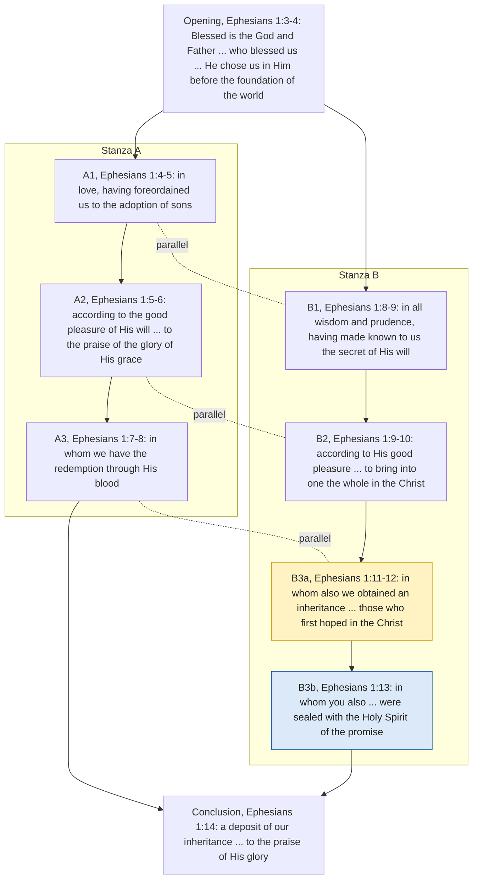
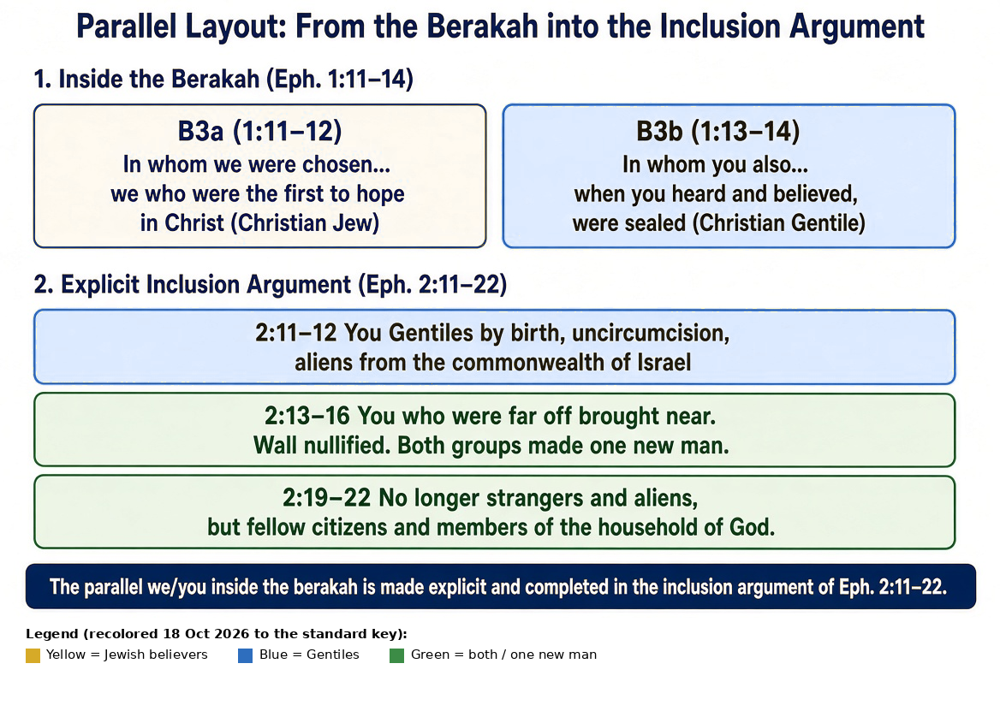
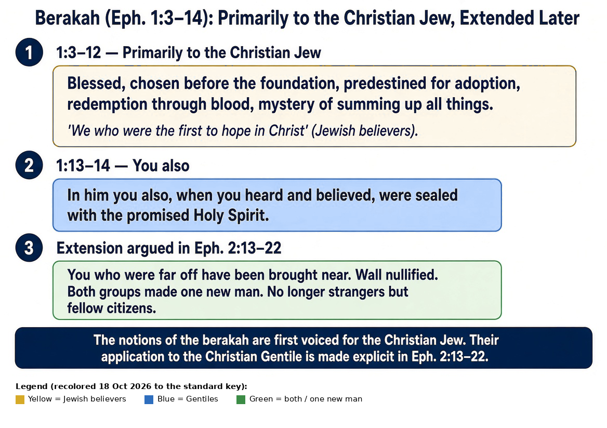

# Ephesians 2: the audience, the wall, and the new creation
{: .no_toc}

## Contents
{: .no_toc}

* Contents
{:toc}

---

## About this example

A worked passage study, prepared as the handout for the first session of a two-person study of Ephesians. It reads Ephesians 2:1–10 inside the letter's own argument about how Gentiles are brought into the one new man (Ephesians 2:11–22), using a color-coded [audience mapping of Ephesians 1–6](ephesians-1-6-audience-mapping.md). An AI assistant helped draft and check it; the assistant is not cited as a source, and every quotation was checked against the edition named.

### The reading argued here, and its limits

This page argues **one reading**: that Ephesians 1–3 speaks in a corporate register (two peoples made one), so Ephesians 2:8–10 is heard first inside the Jew–Gentile argument rather than as a free-standing statement about individual effort. That reading has serious support (Witherington 2007; Selby 2016; the NET translators' note on "one new man" at Ephesians 2:15), and it also has serious critics (Thielman 2010 on Ephesians 2:3; many Reformed and Lutheran readers on Ephesians 2:8–9; Chrysostom on the wall). Section 5 sets out how the main traditions read the passage, each in its own terms. Three limits are kept throughout:

1. The result is **one new man**, not two ethnic groups left side by side.
2. Reading the "works" of Ephesians 2:9 as the works that built the wall does **not** reduce every Pauline use of "works" (for example Romans 4:4–5) to ethnic markers.
3. "Ephesians is not a generic statement about faith versus human effort" is an **inference** from the letter's center, not a sentence the letter prints. A corporate frame does not deny that the people are made of persons who were each dead and each believe (Ephesians 1:13; Ephesians 2:1).

### Conventions

- **Scripture** is the *Literal Standard Version* (LSV, © 2020 Covenant Press; CC BY-SA 4.0; text unaltered) unless another translation is named. Where the argument turns on the NET's wording (Ephesians 2:14–15), the NET 2nd edition is quoted and labeled. Ellipses mark omissions. To compare translations, see [Ephesians 2 on Bible Gateway](https://www.biblegateway.com/passage/?search=Ephesians%202&version=NET;ESV;NKJV;KJV).
- **NET translators' notes** are summarized and linked, not reproduced: read them at [netbible.org: Ephesians 1](https://netbible.org/bible/Ephesians+1) and [netbible.org: Ephesians 2](https://netbible.org/bible/Ephesians+2).
- **References** are written in full (book chapter:verse).
- **Commentaries** under copyright are quoted briefly and otherwise summarized, with page numbers. Chrysostom is quoted from the public-domain NPNF translation.
- **Confession and catechism citations** stay in plain text: WCF 3.6, WCF 10, WCF 11.1–2, WCF 16.2, WCF 17, Belgic Confession 24, Heidelberg Catechism Q.64, Apology of the Augsburg Confession IV, Augsburg Confession VI, Confession of Dositheus Decrees 3, 9 and 13.

### Color key

| Color | Meaning |
|---|---|
| Yellow (gold) | Jewish believers, "those who first hoped," Israel-tied terms while the distinction is drawn |
| Blue | Gentiles, "you," the nations |
| Green | both, the one new man, fellow-heirs |
| Pink | the Ephesians 2:1–10 block (grace, faith, not of works), always read with Ephesians 2:11–22 |
| Red flag | transitional hinge ("but God," "for this reason," "but now") |
{: .aud-legend}

The verse-by-verse version of the key, including Purple (Paul) and Gray (ambiguous), is in the [mapping](ephesians-1-6-audience-mapping.md#color-key).

## Chart: Distinction, Extension, Walk (Ephesians 1–6)

*Our chart. The Ephesians 2:8–10 band sits inside the sequence that continues through Ephesians 2:11–22: on this reading, the anti-boast sentence is completed by the inclusion argument that follows.*

**Text version of the chart** (LSV wording):

- **Chapter 1**
  - Yellow Ephesians 1:3–12: "Blessed [is] the God and Father… who blessed us… He chose us in Him… to the praise of the glory of His grace… those who first hoped in the Christ."
  - Blue Ephesians 1:13: "in whom you also, having heard the word of the truth—the good news of your salvation—in whom also having believed, you were sealed."
  - Yellow Ephesians 1:14: "which is a deposit of our inheritance."
  - Red flag Ephesians 1:15 "Because of this."
- **Chapter 2**
  - Pink Ephesians 2:1–10: "Also you—being dead in trespasses and sins… but God… made us alive together with the Christ… for by grace you are saved, through faith… not of works, that no one may boast; for we are His workmanship."
  - Blue Ephesians 2:11–12: "For this reason, remember, that you [were] once the nations in the flesh… Uncircumcision… apart from Christ, having been alienated from the commonwealth of Israel."
  - Green Ephesians 2:13–18: "but now, in Christ Jesus, you being once far off became near… for He is our peace, who made both one… that He might create the two into one new man."
  - Green Ephesians 2:19–22: "Then, therefore, you are no longer strangers and foreigners, but fellow-citizens of the holy ones, and of the household of God… built together."
  - Red flags Ephesians 2:1 "Also"; Ephesians 2:4 "but God"; Ephesians 2:11 "For this reason"; Ephesians 2:13 "but now,"; Ephesians 2:19 "Then, therefore,".
- **Chapter 3**
  - Green Ephesians 3:6: "that the nations are fellow-heirs, and of the same body, and partakers of His promise in the Christ, through the good news."
  - Red flags Ephesians 3:1 "For this cause"; Ephesians 3:14 "For this cause".
- **Chapters 4–6** (gear shift from the corporate constitution of the people in chapters 1–3 to the walk of persons in the one new man)
  - Blue Ephesians 4:1: "I… then call on you to walk worthily of the calling with which you were called…" The walk of the one new man: personal conduct inside the united body of Jewish and Gentile believers.
  - Red flag Ephesians 4:1 "then call on".

## The question

What does Ephesians 2:1–10 require when it is read inside the letter's own account of how Gentiles are brought into the one new man?

Every major tradition reads this paragraph closely, and each hears a different emphasis. Confessional Reformed readings (WCF, the 1689 Baptist Confession, Dort, the Belgic Confession, the Heidelberg Catechism) usually hear Ephesians 2:8–9 as protecting justification by grace through faith, not grounded in works (WCF 11.1–2), and Ephesians 2:10 as the fruits and evidences of a true faith (WCF 16.2). Lutheran readings (Apology IV, Augsburg Confession VI) keep the same structure: the verdict is by faith, and the walk is new obedience that must follow but must not justify. Eastern Orthodox readings (Chrysostom; the Orthodox Study Bible; Confession of Dositheus Decrees 9 and 13) agree that grace is first and boasting excluded, but they do not let works be only certificates of a past calling: faith works through love, and the walk is how that faith becomes effective. Classic Arminian and Wesleyan readings keep the gift real and resistible, and leave open that the walk can be left. Sections 1–4 stay with the letter; section 5 lets each tradition speak.

## 1. The sentence

On the reading argued here, the register of Ephesians 1–3 is corporate. The pronouns name groups: "those who first hoped in the Christ" (Ephesians 1:12, LSV) and "you also" (Ephesians 1:13, LSV); "you [were] once the nations in the flesh" (Ephesians 2:11, LSV); "who made both one" and "the two into one new man" (Ephesians 2:14–15, LSV); "the nations are fellow-heirs" (Ephesians 3:6, LSV). The argument of these chapters is how two corporate identities are brought into one new humanity. Persons hear and believe, but the letter's concern here is the constitution of a people. Chapters 4–6 shift gear into the walk and the household. The NET translators make a similar point at Ephesians 2:15: their note reads "one new man" as a new corporate entity in Christ rather than a new individual ([NET note on Ephesians 2:15](https://netbible.org/bible/Ephesians+2)). Readers who hear Ephesians 2:8–10 as a general statement about every individual's effort are not ignoring the text: Ephesians 2:1–3 does say "we also all" and "as also the others." The question is which frame comes first.

Paul begins with the former condition of the hearers. "Also you—being dead in trespasses and sins, in which you once walked according to the age of this world, according to the ruler of the authority of the air" (Ephesians 2:1–2, LSV). That death was not inactivity. It was a walked death. "We also all walked once in the desires of our flesh… and were by nature children of wrath—as also the others" (Ephesians 2:3, LSV).

Then the contrast: "but God, being rich in kindness, because of His great love with which He loved us, even being dead in the trespasses, made us alive together with the Christ (by grace you are saved), and raised [us] up together, and sat [us] together in the heavenly [places] in Christ Jesus" (Ephesians 2:4–6, LSV). The subject of the verbs is God. The dead do not make themselves alive.

Then the sentence that is usually quoted by itself:

> for by grace you are saved, through faith, and this [is] not of yourselves—[it is] the gift of God, not of works, that no one may boast; for we are His workmanship, created in Christ Jesus on good works, which God prepared before, that we may walk in them.
>
> — Ephesians 2:8–10, LSV

Two common ways of holding the sentence together are these.

One reading treats Ephesians 2:8–9 as the statement of source and means, and Ephesians 2:10 as the evidence that follows, so no one turns grace into carelessness. WCF 16.2 cites the workmanship line and calls the works fruits and evidences of a true and lively faith.

The other reading treats Ephesians 2:8–9 as excluding self-origin and boasting, and Ephesians 2:10 as naming the purpose of the new creation itself. The people who have been saved are remade for the works God prepared. The walk is what they are created for, not only later proof that the rescue happened.

The practical question is whether "not of works" is allowed to thin "created… on good works" until it means only evidence, and whether "created… on good works" is allowed to climb back into the place of ground or boast that Ephesians 2:9 has already closed.

It helps to keep three jobs distinct. Source, gift, and the exclusion of boasting belong to Ephesians 2:4–9. A wage (the worker is owed) is the concern of Romans 4:4–5, a nearby but different sentence. The prepared walk of the new creation is Ephesians 2:10. These are not the same claim.

## 2. A few words in this letter

"Dead" in Ephesians 2:1 and Ephesians 2:5 describes persons who are dead in trespasses and are then made alive with Christ. "Dead" in James 2:17 describes a named faith that has no works. The words belong to the same family but do different jobs. One sentence does not automatically decide the other.

"Walk" appears in Ephesians 2:2 and again in Ephesians 2:10. They once walked in trespasses; now they are to walk in the good works God prepared. If a reading makes Ephesians 2:10 only evidence, it still has to explain why Paul used the same verb for the old life and the new purpose.

"Grace" in this paragraph is the source: rich kindness (LSV; "mercy" in most translations), great love, kindness toward us in Christ Jesus (Ephesians 2:4–7). It is not a payment for work done.

"Saved" in Ephesians 2:5 and Ephesians 2:8 is a Greek perfect. The NET translators' note explains that the tense carries both a completed action and its continuing result ("you have been saved," "you are saved"; [NET note on Ephesians 2:5](https://netbible.org/bible/Ephesians+2)). The tense is real. It does not, by itself, settle whether the walk of Ephesians 2:10 can fail.

"Through faith" fits the language of means. It does not yet contain the later confessional sentence that faith is the alone instrument yet is never alone in the person who has it (WCF 11.2). That second clause is the Westminster Assembly's.

"Works" does more than one job in this letter. The definitions are in section 3.9.

## 3. Who the letter is addressing, and what it is arguing

On this reading, Ephesians is not first a free-standing essay on faith versus every kind of human effort. It tells its hearers who they were, who they now are, and what God has done to bring two groups together.

### 3.1 The pronouns

In Ephesians 1:11–13 Paul speaks of "we" who "obtained an inheritance… those who first hoped in the Christ" and then of "you also, having heard the word of the truth… in whom also having believed, you were sealed" (LSV). The "we" are most naturally the Jewish believers; the "you also" are the Gentiles who later heard and believed. (The NET translators note that Ephesians 1:12 can also be rendered "who had already hoped"; [NET note on Ephesians 1:12](https://netbible.org/bible/Ephesians+1).)

A tighter reading takes Ephesians 1:3–12 as voiced primarily for Jewish believers. The "we" who were chosen, foreordained, redeemed, and who "first hoped in the Christ" (Ephesians 1:12, LSV) are the Jewish believers. The blessings of the berakah (the Jewish form of blessing God that Ephesians 1:3–14 follows: election before the foundation, adoption, redemption through blood, the secret of bringing all things into one) are first voiced as the blessings of that people. The shift comes at Ephesians 1:13: "in whom you also… were sealed." The extension of the same blessings to Gentile believers is argued explicitly in Ephesians 2:13–22.

Readers differ here. Selby (2016) sees the berakah already rehearsing the unity themes and notes the pronoun shift inside it; Thielman (2010) keeps any ethnic reading of the "we" in Ephesians 2:1–3 cautious until the explicit address of Ephesians 2:11; many readers take every "we" in Ephesians 1:3–12 as all believers. The printed markers that do the work are the restriction in Ephesians 1:12 ("those who first hoped") and the explicit Gentile address in Ephesians 2:11–12.

### 3.2 Witherington on the we/you and election (2007)

Witherington reads the shift from "we" to "you" in Ephesians 1:12–13 as distinguishing Jewish Christians (those who "hoped first") from the largely Gentile audience. He takes the "saints" of Ephesians 1:1 as Jewish Christians and sees this as preparing for the explicit "you" of Ephesians 2:11–20 and the grafting image of Romans 11:17–24 (Witherington 2007, pp. 230–231). On election he stresses "in Christ": believers were chosen in the preexistent Christ, the Elect One, so the concept is corporate (if one is in Christ, one is elect) rather than a pre-temporal choosing of individuals apart from Christ. He compares it to Israel: one was elect by being in Israel; individuals could opt out by apostasy, and others, like Ruth, could be grafted in (Witherington 2007, pp. 233–235). Witherington writes from a Wesleyan tradition, and his reading is close to classic Arminian accounts of corporate election (section 5.4).

### 3.3 Thielman's caution on Ephesians 2:3 (2010)

Thielman disagrees with the "vast company of interpreters" who take "we also" in Ephesians 2:3 to mean "we Jews also":

> Paul certainly does this in Romans (2:17; 3:19, 22b–23), but in Ephesians ethnicity does not enter the argument until 2:11. Here in 2:3, those who first heard this letter read would have no way of knowing that the first-person plural meant anything other than what it meant when it last appeared in the text.
>
> — Frank Thielman, *Ephesians* (BECNT; Baker Academic, 2010), pp. 125–127

So the mapping keeps Ephesians 2:3 marked as ambiguous (gray asterisk). The restricted "we" of Ephesians 1:12 is a stronger marker than the "we also all" of Ephesians 2:3. On Ephesians 1:4 Thielman also argues, with Deuteronomy 7:1–6, that the holiness God confers in choosing a people is "at the same time, a call to act in the holy ways that God prescribes" (Thielman 2010, p. 50), which sits well with the walk of Ephesians 2:10.

### 3.4 Witherington on Ephesians 2 (2007)

Witherington treats Ephesians 2:1–10 as *narratio*, a "then–now" reminder of the Gentiles' former condition and present rescue that prepares for the exhortations that follow (Witherington 2007, pp. 250–251). He reads the author as a Jewish Christian writing mainly to Gentiles, and takes the "we" of Ephesians 2:3 as Jewish Christians who once lived by the desires of the flesh: not destined for wrath, but acting in a fallen way like everyone else. Thielman reads both points differently (section 3.3; Thielman 2010, pp. 125–127, on "children of wrath" as a genitive of destination). On Ephesians 2:11–22 Witherington stresses the indebtedness of Gentile Christians to their Jewish forebears: "Israel" in Ephesians 2:12 is pre-Christian Israel, and the theology is incorporation (as in Romans 11), not simple replacement. As he puts it, "A few Gentile proselytes to Judaism through the years does not constitute the unification of humankind" (Witherington 2007, pp. 252–263).

On "works" in Ephesians 2:9 he writes:

> In v. 9 "works" refers to human efforts, not works of the Law. Paul will deal with the latter later in the discourse. Thus there is no reason for the believer to boast as if he has accomplished his own salvation. Rather, saved people are God's handiwork, and they have been saved to serve, created in Christ Jesus for a specific purpose—to do good works.
>
> — Ben Witherington III, *The Letters to Philemon, the Colossians, and the Ephesians* (Eerdmans, 2007), p. 254 (footnote markers omitted)

He goes on to say that these works are a grateful response to the gift, not a way of earning favor, and that God prepared this way of life in advance for those he saved (p. 254).

Witherington's claim that "works" here has nothing to do with works of the Law is stated more than demonstrated, and this page treats it as one commentator's judgment. Ephesians 2:9 says "not of works." The immediate context (Ephesians 2:11–15) supplies "the Law of the commands in ordinances." Reading the excluded works as the wall-building works is a strong contextual inference; treating "works" as a generic ban on all human effort, or as unrelated to the Law about to be named, is also an inference. Primary referent first; wider or narrower application must be shown.

In Ephesians 2:1–6 the "you" were dead and walked in sins; the "we" were made alive together, raised, and seated. In Ephesians 2:11–12 the identification is explicit:

> For this reason, remember, that you [were] once the nations in the flesh, who are called Uncircumcision by that called Circumcision in the flesh made by hands, that you were at that time apart from Christ, having been alienated from the commonwealth of Israel, and strangers to the covenants of the promise, having no hope, and without God in the world.
>
> — Ephesians 2:11–12, LSV

In Ephesians 3:1–6 Paul states the secret: "that the nations are fellow-heirs, and of the same body, and partakers of His promise in the Christ, through the good news" (Ephesians 3:6, LSV). Even the ethical section keeps the old category in view: "you are no longer to walk, as also the other nations walk" (Ephesians 4:17, LSV).

### 3.5 The mystery and the wall

The center of the letter is that mystery (LSV "secret"). God's purpose is "to bring into one the whole in the Christ" (Ephesians 1:10, LSV). Part of that purpose, now revealed, is that the far-off Gentiles are brought into the one new man without first being required to become Jews (Ephesians 2:14–16; Ephesians 3:6). Ephesians 1–3 establish the mystery; Ephesians 4 onward describes the walk of the people who have been brought in.

The paragraph that explains the change is Ephesians 2:14–15. Here the NET's wording matters:

> For he is our peace, the one who made both groups into one and who destroyed the middle wall of partition, the hostility, when he nullified in his flesh the law of commandments in decrees. He did this to create in himself one new man out of two, thus making peace,
>
> — Ephesians 2:14–15, NET 2nd ed. (Scripture quoted by permission. Quotations designated NET are from the NET Bible® copyright ©1996, 2019 by Biblical Studies Press, L.L.C. [netbible.com](https://netbible.com). All rights reserved.)

The LSV has "having done away [with] the Law of the commands in ordinances." The verb is καταργέω (katargeō). The NET translators' note offers "rendered inoperative" as an alternative and explains that the legal terminology makes the word hard to render ([NET note on Ephesians 2:15](https://netbible.org/bible/Ephesians+2)). "Nullified" or "rendered inoperative" is the better English if "abolished" is heard as the total destruction of every command God ever gave. On this reading, what Christ ends is the Law's power to function as the dividing wall: the commandments in decrees that marked Jew from Gentile and kept the hostility in place. The letter does not stop giving commands after this; chapters 4–6 are full of them. The dividing function is finished. Moral instruction is not.

Chrysostom reads the wall differently, and the reading here has to face him (section 5.3): he knows the Jew-versus-Greek reading of the wall and prefers to read it as the enmity that cut both Jews and Gentiles off from God.

### 3.6 Two boasts closed

The frame also explains the anti-boast clause. Under the Mosaic regime a Gentile could enter the covenants by taking on the Law's markers and becoming a proselyte. "Not of works, that no one may boast" (Ephesians 2:9, LSV) can close two boasts that belonged to that arrangement: the Gentile who performed the required markers and could say the inheritance was now his by an action he chose, and the Jew who treated the Law itself as the method by which the inheritance is secured and Gentiles admitted. "No one" covers both sides of the wall.

### 3.7 A precision on wording: "not of works"

Ephesians 2:9 says "not of works" (LSV; NET "not from works"). It does not say "not from works of the law," the fuller phrase of Galatians 2:16, Romans 3:20 and Romans 3:28. In Ephesians the immediate context supplies the Law: Ephesians 2:15 names the Law of the commands in ordinances that is done away (NET "nullified"), and Ephesians 2:11–12 has already identified the audience as Gentiles formerly outside that Law's markers. So reading the excluded works as the works that built the wall is a strong contextual inference, not a quotation. Many interpreters draw the opposite conclusion from the same fact: that Ephesians drops "of the law" because it applies the principle to all human doing (section 5.2). Keeping both visible prevents the inference from being treated as the text, and prevents the bare word "works" from being widened before Ephesians 2:10 and Ephesians 2:14–15 have been allowed to speak.

### 3.8 The prepared walk, and those outside

The same paragraph that excludes those works names the purpose of the people brought in: "for we are His workmanship, created in Christ Jesus on good works, which God prepared before, that we may walk in them" (Ephesians 2:10, LSV). The way in is faith. The new creation is for a walk. Ephesians 1:10 and Ephesians 3:9–10 place this inside the eternal purpose now revealed, even "to the principalities and the authorities in the heavenly [places]" (Ephesians 3:10, LSV). The one new man already exists; the full bringing of all things into one is still ahead.

Those who do not come by faith in Christ remain what Ephesians 2:12 describes: "apart from Christ, having been alienated from the commonwealth of Israel, and strangers to the covenants of the promise, having no hope, and without God in the world" (LSV). The old gate is not left open as a live alternative.

### 3.9 Three definitions and one summary sentence

- **Works of the Law**, in the Ephesians frame, are the commandments in decrees that functioned as the middle wall: the markers and observances by which a Gentile became a Jew and by which Israel's distinct covenant identity was maintained.
- **Works in Ephesians 2:9** are the works excluded so that no one may boast. On this reading, in sequence with Ephesians 2:11–15, these are first the works that built the wall; the purpose clause limits the range to what produces boasting in self-origin or in the old gate.
- **Good works in Ephesians 2:10** are the works God prepared beforehand for the new creation to walk in. The root word is the same (ἔργον, ergon); the job is different. They are the path after the wall is down, not the toll that kept the wall up.

A sentence that holds the movement together, on this reading:

> The Law told a Gentile how to become a Jew. Christ nullified that wall in his flesh (Ephesians 2:15). So we are saved by grace through faith, not of those works of the Law that built the wall, so that neither side can boast (Ephesians 2:8–9). The people brought in are God's workmanship, created in Christ for the good works he prepared, that we should walk in them (Ephesians 2:10). The mystery is now public (Ephesians 3:6). Those who do not cross by faith in Christ remain outside (Ephesians 2:12).

## 4. Diagrams

Scripture wording inside the diagrams in 4.2–4.4 is a summary paraphrase, not a translation. Section 4.1 uses LSV wording.

### 4.1 The parallel structure of the berakah (Ephesians 1:3–14), after Selby

Our own outline of the structure that Selby (2016, pp. 112–118) lays out for Ephesians 1:3–14, building on earlier analyses (he credits Dibelius, Käsemann and others for the "in love" / "in all wisdom" pattern). The wording is the LSV (abridged, with the LSV's brackets dropped inside the diagram), not Selby's translation; the arrangement follows his analysis. Selby's two stanzas (A and B) run in parallel, each with three units, and the last B unit splits into "we" and "you also." The yellow and blue on B3a and B3b are our audience-key overlay, not Selby's.

**Text version:**

- **Opening** (Ephesians 1:3–4): Blessed [is] the God and Father of our Lord Jesus Christ, who blessed us… He chose us in Him before the foundation of the world.
- **Stanza A**
  - **A1** "in love" (Ephesians 1:4–5): having foreordained us to the adoption of sons
  - **A2** "according to the good pleasure of His will" (Ephesians 1:5–6): to the praise of the glory of His grace
  - **A3** (Ephesians 1:7–8): in whom we have the redemption through His blood
- **Stanza B**
  - **B1** "in all wisdom and prudence" (Ephesians 1:8–9): having made known to us the secret of His will
  - **B2** "according to His good pleasure" (Ephesians 1:9–10): to bring into one the whole in the Christ
  - B3a (Ephesians 1:11–12): in whom also we obtained an inheritance… those who first hoped in the Christ
  - B3b (Ephesians 1:13): in whom you also… were sealed with the Holy Spirit of the promise
- **Conclusion** (Ephesians 1:14): a deposit of our inheritance… to the praise of His glory.

### 4.2 From the berakah into the inclusion argument

**Text version:**

1. Inside the berakah (Ephesians 1:11–14)
   - Yellow B3a (Ephesians 1:11–12): in whom we were chosen… we who were the first to hope in Christ (Jewish believers)
   - Blue B3b (Ephesians 1:13–14): in whom you also… when you heard and believed, were sealed (Gentile believers)
2. Explicit inclusion argument (Ephesians 2:11–22)
   - Blue Ephesians 2:11–12: you Gentiles by birth, uncircumcision, aliens from the commonwealth of Israel
   - Green Ephesians 2:13–16: you who were far off brought near; wall nullified; both groups made one new man
   - Green Ephesians 2:19–22: no longer strangers and aliens, but fellow citizens and members of the household of God

### 4.3 The berakah primarily to Jewish believers, extended in Ephesians 2:13–22

**Text version:**

1. Yellow Ephesians 1:3–12, primarily to Jewish believers: blessed, chosen before the foundation, predestined for adoption, redemption through blood, mystery of bringing all things into one. "We who were the first to hope in Christ."
2. Blue Ephesians 1:13–14, you also: in him you also, when you heard and believed, were sealed with the promised Holy Spirit.
3. Green Extension argued in Ephesians 2:13–22: you who were far off have been brought near; wall nullified; both groups made one new man; no longer strangers but fellow citizens.

On this reading, the blessings of the berakah are first voiced for Jewish believers, and their application to Gentile believers is made explicit in Ephesians 2:13–22. Readers who take the "we" of Ephesians 1:3–12 as all believers would color that block Green.

### 4.4 We / You and the mystery through Ephesians

**Text version:**

1. Ephesians 1:1, address: to the saints in Ephesus, the faithful in Christ Jesus.
2. Ephesians 1:11–13, we / you also: Yellow WE who were the first to hope in Christ (Jewish believers); Blue YOU ALSO when you heard and believed (Gentiles).
3. Ephesians 2:1–6, you dead → we made alive: Blue YOU were dead, walked in sins; Green WE (including former Gentiles) made alive, raised, seated together. (Thielman cautions that the "we" of Ephesians 2:3 is not yet ethnic; section 3.3.)
4. Pink Ephesians 2:8–10, grace, faith, not of works: by grace you are saved through faith… not of works, that no one may boast; created in Christ Jesus for good works prepared beforehand to walk in. (Spoken inside the Gentile-inclusion argument.)
5. Ephesians 2:11–15, frame and the wall: Blue YOU Gentiles by birth, called the uncircumcision, aliens from the commonwealth of Israel; Green Christ nullified (katargeō) in his flesh the law of commandments in decrees; middle wall of hostility destroyed; both groups made one new man. Side note: two boasts closed: (1) the Gentile who took the proselyte route by the Law's markers; (2) the Jew who treated the Law as the gate.
6. Ephesians 3:1–6, the mystery: Green Gentiles are fellow heirs, members of the same body, partakers of the promise in Christ, now revealed even to the powers (Ephesians 3:9–10).
7. Ephesians 4:17–24, walk: Blue YOU must no longer walk as the Gentiles do… put on the new man.
8. Summary: bringing all things into one in Christ (Ephesians 1:10) is the letter's center. New creation, now and not yet. The way in is faith in Christ; no restored old gate; those outside remain without Christ (Ephesians 2:12). On this reading, Ephesians 2:9 excludes the wall-building works and Ephesians 2:10 names the prepared walk of the new man.

## 5. How the main traditions read Ephesians 2:1–10

Each tradition below is described in its own terms: what it presses, how it answers the corporate (group) reading of this page, and what its critics say it must still explain.

### 5.1 Confessional Reformed

**What it presses.** Ephesians 2:1–5 is spiritual death and effectual calling: the dead are made alive by God alone (WCF 10). Ephesians 2:8–9 is the classic gift sentence that protects justification by grace through faith, not grounded in any works (WCF 11.1). "This [is] not of yourselves" is commonly applied to the whole of salvation, faith included. Ephesians 2:10 names good works as fruits and evidences of a true faith (WCF 16.2), prepared by God as the means to the end he appointed (WCF 3.6). Belgic Confession 24 and Heidelberg Catechism Q.64 make the same move: good works necessarily follow, and grace does not make people careless.

**On the group reading.** Reformed exegetes usually grant the Jew–Gentile frame but deny that it excludes individuals: the "us" chosen "in Him" (Ephesians 1:4) are persons, each once dead (Ephesians 2:1), each believing (Ephesians 1:13). Corporate election in Christ is, on this view, the election of the persons who make up the body. Thielman's caution on Ephesians 2:3 (section 3.3) and his critique of Chrysostom on Ephesians 1:4 (section 5.3) are typical of that line.

**What critics say it must explain.** Whether "evidence only" does justice to "created… on good works," and how warnings such as James 5:19–20 and Ephesians 5:5–6 work if the walk cannot finally fail (WCF 17).

### 5.2 Lutheran

**What it presses.** Ephesians 2:8–9 is the gospel in brief: justification by grace through faith alone, apart from all works. Ephesians 2:10 is new obedience that must follow and must not justify (Apology of the Augsburg Confession IV; Augsburg Confession VI).

**On the group reading.** Lutheran and other "old perspective" readers often point to the very fact noted in section 3.7: Ephesians says "not of works," not "not of works of the law." On their reading, the letter applies Paul's principle to all human doing, so the Jew–Gentile setting is the occasion, not the limit, of the claim. I. Howard Marshall made a well-known case of this kind for the later Pauline letters ("Salvation, Grace and Works in the Later Writings in the Pauline Corpus," *New Testament Studies* 42, 1996). The universal "we also all… as also the others" of Ephesians 2:3 supports them.

**What critics say it must explain.** Why Ephesians 2:11–15 immediately names the Law and the wall if the works of Ephesians 2:9 are generic; and how "created… on good works" relates to a walk that is described as only following.

### 5.3 Eastern Orthodox

**What it presses.** Grace is first, faith is not "of ourselves," and works are required, not as payment but as the life of faith. Chrysostom (4th century) reads Ephesians 2:8 as excluding self-origin even for faith, while refusing to let faith stand without works:

> Neither is faith, he means, of ourselves. Because had He not come, had He not called us, how had we been able to believe?… Was faith then, you will say, enough to save us? No; but God, says he, has required this, lest He should save us, barren and without work at all.
>
> — John Chrysostom, *Homilies on Ephesians* 4, on Ephesians 2:8 (NPNF¹ 13; [New Advent](https://www.newadvent.org/fathers/230104.htm))

On Ephesians 2:9 he adds: "He did not reject us as having works, but as abandoned of works He has saved us by grace; so that no man henceforth may have whereof to boast." On Ephesians 2:10 he reads "workmanship" as regeneration, "a second creation."

The *Orthodox Study Bible* puts the point in one line, "We are not saved by good works, but for good works (v. 10)," and describes grace, faith and works as united but not equal: grace is uncreated, faith can grow, and good works flow out of authentic faith. Its sidebar on "works" in Paul distinguishes dead works from living works and says Paul "is not putting down works in general, but dead works" (Jack N. Sparks, ed., *The Orthodox Study Bible*, Thomas Nelson, 2008, notes on Ephesians 2:1–10).

The Confession of Dositheus (1672) says faith "working by love, that is to say, by [keeping] the Divine commandments, justifies us with Christ" (Decree 9), and that a person is justified "not simply… through faith alone, but through faith which works through love" (Decree 13); Decree 3 speaks of the grace a person cooperates with as making him predestinated ([text](https://crivoice.org/creeddositheus.html)). Many Orthodox give the Fathers more weight than this 17th-century local confession, which was written largely as a reply to Calvinism.

**On election.** On Ephesians 1:4 Chrysostom says God's choice is "at once a token of the loving kindness of God, and of their moral goodness," and that predestination "is the result neither of His love alone, nor yet of our virtue, but of both" (Homily 1, NPNF¹ 13). Thielman calls this "precisely the wrong way" to read Ephesians 1:4, taking Chrysostom to mean that God chose believers because he foresaw their moral excellence (Thielman 2010, pp. 48–49 n. 5). In fairness to Chrysostom, the same homily says "our being rendered virtuous, and believing, and coming near unto Him, even this again was the work of Him that called us Himself, and yet, notwithstanding, it is ours also." That is synergy (grace and the person both act), not merit that earns the choice. Thielman's own reading of Ephesians 1:4 also makes holiness both a status God confers and a call to live it (p. 50), close to Chrysostom's "He has Himself rendered us holy, but then we must continue holy."

**On the wall: Chrysostom's counter-reading.** On Ephesians 2:14–15 Chrysostom considers the reading this page argues for and sets it aside:

> Some indeed affirm that he means the wall of the Jews against the Greeks, because it did not allow the Jews to hold intercourse with the Greeks. To me, however, this does not seem to be the meaning, but rather that he calls the enmity in the flesh, a middle wall, in that it is a common barrier, cutting us off alike from God.
>
> — John Chrysostom, *Homilies on Ephesians* 5, on Ephesians 2:14 (NPNF¹ 13; [New Advent](https://www.newadvent.org/fathers/230105.htm))

He still calls the Law "a hedge" that, being disobeyed, "became… a middle wall, no longer establishing them in security, but cutting them off from God." So Chrysostom's wall is first vertical (humanity and God) and only then horizontal. The text holds both together (Ephesians 2:14 "who made both one"; Ephesians 2:15 "the two into one new man"; Ephesians 2:16 "reconcile both in one body to God"). The fair statement is that the horizontal reading of this page is the one Chrysostom names and sets aside; the most this page can claim is that Ephesians 2:14–16 requires both directions, not the horizontal alone. Theophylact of Ohrid's 11th-century commentary on Ephesians is a further Orthodox witness not quoted here.

**What critics say it must explain.** How cooperative language (Decree 3 especially) answers Romans 4:5 and the anti-boast clause of Ephesians 2:9.

### 5.4 Arminian and Wesleyan

**What it presses.** The gift is real and can be refused; grace goes before and enables faith (prevenient grace); the prepared walk of Ephesians 2:10 is the life of the saved and can be left, which gives the warnings of Ephesians 5:5–6 and James 5:19–20 their force.

**On the group reading.** This tradition is the most at home with corporate election. "In Him" (Ephesians 1:4) is read as the election of a people in Christ, the Elect One, with persons coming to be in that people by faith (Ephesians 1:13), much as Witherington argues (section 3.2). William W. Klein's *The New Chosen People: A Corporate View of Election* (1990) is a standard statement.

**What critics say it must explain.** How the perfect tense of "you are saved" (Ephesians 2:5, 2:8) and "which God prepared before" (Ephesians 2:10) fit a walk that can finally fail, and whether corporate election answers the question of why particular persons believe.

### 5.5 Quotation is not settlement

All four can quote Ephesians 2:8–10, and each sees something in it the others are tempted to thin out. Quotation is not the same as settlement. The letter's own sequence (the inclusion argument, the wall nullified, the one new man, the prepared walk) is the control on how far any of the readings can go, including the corporate reading of this page.

## 6. Questions the text itself raises

1. When "works" is said in Ephesians 2:9, is the range set by the wall that Ephesians 2:14–15 names, or has that frame already been left behind by the time the sentence is reached?
2. Does "not of works" exclude the prepared walk of Ephesians 2:10 from the source of salvation, or from the life of salvation?
3. Does "prepared before" (Ephesians 2:10) make the walk certain in the sense later confessions give that phrase, or does it simply name the path that has already been given?
4. Does "nullified" (NET) or "having done away [with]" (LSV) in Ephesians 2:15 end only the Law's dividing function, or every command? The fact that the letter continues to give commands suggests the first.
5. Is the wall of Ephesians 2:14 first between Jew and Gentile, first between humanity and God (Chrysostom), or both at once?
6. Can the language of "fruits and evidences" (WCF 16.2) account for the full force of "created… on good works"?
7. Can a reading that keeps a real human response still preserve the anti-boast force of Ephesians 2:9?
8. If the register of Ephesians 1–3 is corporate, what does the letter say about how a particular person comes to belong to the people (Ephesians 1:13; Ephesians 2:8)?

## 7. Note: Galatians, Colossians, Ephesians and Romans read thematically

*This is a thematic reading order, not a chronology.* On common dating, Romans (about AD 57) was written before Colossians and Ephesians (usually placed in Paul's imprisonment, about AD 60–62); Galatians is usually placed earlier than Romans, though its date is debated. The sequence below is about widening scope, not the order of composition.

Reading Galatians, Colossians and Ephesians in parallel suggests a sequence in the way Paul addresses the Jew/Gentile question. Galatians is the sharpest and most personal: Paul defends the gospel he received and the table he shared with Gentiles (Galatians 2:11–16). The issue is whether Gentile believers must take on the markers that made someone a Jew. Colossians keeps the same center but widens the frame: the fullness of Christ (Colossians 2:9–10) and the warning against returning to the elemental principles (Colossians 2:8; Colossians 2:20) serve the point that the Gentile church does not need to adopt the old boundary system. Ephesians takes the next step: it begins with the berakah that names the first to hope, turns explicitly to the Gentile "you," and only then states the mystery as the two becoming one. Romans is the broadest statement: it addresses a mixed church, argues the same gospel from the Scriptures of Israel, and ends with the practical unity of Jew and Gentile in one body (Romans 15:7–12). The four letters can be read as one argument told four ways: Galatians (why the wall cannot be rebuilt), Colossians (what the Gentile church already has in Christ), Ephesians (how the two become one), Romans (the full scriptural case). On this reading, that is why Ephesians 2:8–10 belongs inside the larger inclusion argument; readers in section 5.2 would answer that Romans 4:4–5 shows the principle reaching wider.

## Sources

**Scripture**

- *Literal Standard Version* (Covenant Press, 2020; CC BY-SA 4.0; text unaltered), via [ebible.org/englsv](https://ebible.org/englsv/). Full Ephesians text with colors in the [mapping](ephesians-1-6-audience-mapping.md), which also explains the licence.
- *NET Bible*, 2nd ed. (Biblical Studies Press, 2019): Ephesians 2:14–15 text, quoted by permission. Translators' notes on Ephesians 1:12, 2:5 and 2:15 summarized; read them at [netbible.org](https://netbible.org/bible/Ephesians+2).
- Compare translations: [Ephesians 2 on Bible Gateway](https://www.biblegateway.com/passage/?search=Ephesians%202&version=NET;ESV;NKJV;KJV).
- Other passages cited: Deuteronomy 7:1–6; Galatians 2:11–16; Colossians 2:8–10, 2:20; Romans 3:20, 3:28; Romans 4:4–5; Romans 11:17–24; Romans 15:7–12; James 2:17; James 5:19–20.

**Commentaries and studies** (brief quotations; otherwise summarized)

- Ben Witherington III, *The Letters to Philemon, the Colossians, and the Ephesians: A Socio-Rhetorical Commentary on the Captivity Epistles* (Grand Rapids: Eerdmans, 2007), pp. 230–235 (Ephesians 1:1–14), pp. 250–263 (Ephesians 2), p. 254 (the "works" quotation).
- Gary S. Selby, *Not with Wisdom of Words: Nonrational Persuasion in the New Testament* (Grand Rapids: Eerdmans, 2016), pp. 105–118 (Ephesians 1:3–14; the parallel structure outlined in section 4.1).
- Frank Thielman, *Ephesians*, Baker Exegetical Commentary on the New Testament (Grand Rapids: Baker Academic, 2010), pp. 48–50 (Ephesians 1:4, including pp. 48–49 n. 5 on Chrysostom), pp. 125–127 (Ephesians 2:3).
- David A. deSilva, *Ephesians*, New Cambridge Bible Commentary (Cambridge: Cambridge University Press, 2022), p. 53 (Ephesians 1:3–14 as one 202-word sentence; cited in the mapping).
- I. Howard Marshall, "Salvation, Grace and Works in the Later Writings in the Pauline Corpus," *New Testament Studies* 42 (1996).
- William W. Klein, *The New Chosen People: A Corporate View of Election* (Grand Rapids: Zondervan, 1990).

**Orthodox and patristic**

- John Chrysostom, *Homilies on Ephesians* 1, 4 and 5, trans. Gross Alexander, NPNF First Series vol. 13 (1889; public domain), [New Advent](https://www.newadvent.org/fathers/2301.htm).
- Jack N. Sparks, ed., *The Orthodox Study Bible* (Nashville: Thomas Nelson, 2008), notes on Ephesians 2:1–10 and the sidebar on "works" in Paul's writing.
- Confession of Dositheus (Synod of Jerusalem, 1672), Decrees 3, 9 and 13: [crivoice.org](https://crivoice.org/creeddositheus.html).

**Confessions**

- Westminster Confession of Faith 3.6; 10; 11.1–2; 16.2; 17: [thewestminsterstandard.org](https://thewestminsterstandard.org/the-westminster-confession/)
- Belgic Confession 24: [thewestminsterstandard.org](https://thewestminsterstandard.org/the-belgic-confession/)
- Heidelberg Catechism Q.64: [thewestminsterstandard.org](https://thewestminsterstandard.org/heidelberg-catechism/)
- Apology of the Augsburg Confession IV; Augsburg Confession VI: [bookofconcord.cph.org](https://bookofconcord.cph.org/)
